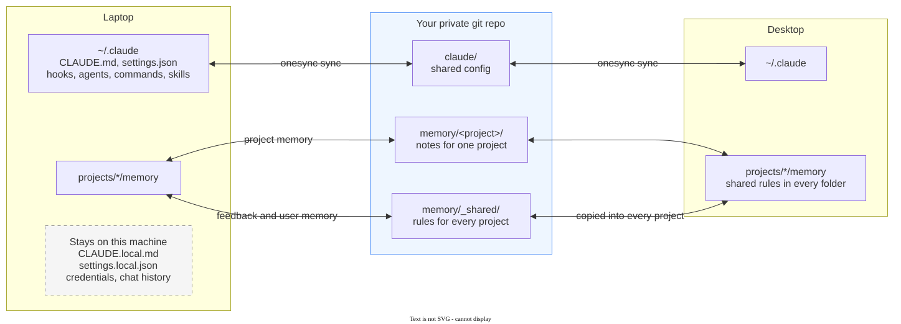
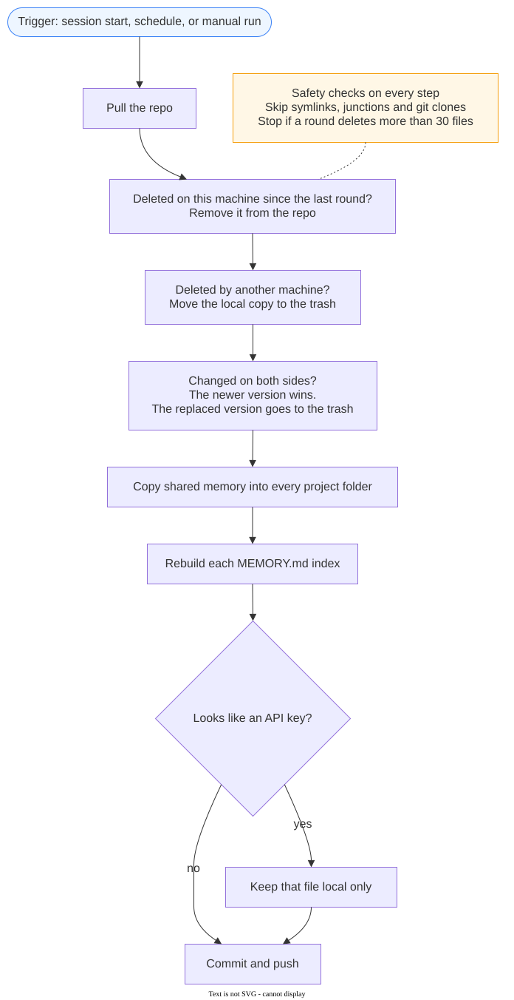

<div align="center">

# claude-onesync

**Change your Claude Code setup on one machine. Every other machine gets it.**

Rules, settings, hooks, agents, skills and memory stay the same on your laptop, your desktop and your servers. Deletes sync too. There is no daemon and no extra service. Your files go only to your own private git repo.

[](https://github.com/Jcxu97/claude-onesync/actions/workflows/test.yml)


[](LICENSE)

English · [中文](README.zh-CN.md)



</div>

## The problem

You teach Claude Code a rule on your laptop. The next day you work on your desktop, and Claude does not know the rule. You add a hook on one machine and forget it on the other. You delete an old skill, and it comes back from a backup.

Copying `~/.claude` by hand does not scale past two machines. A plain git repo or a symlink to a sync folder has other problems:

1. Claude Code keeps memory in a separate folder for each start directory (`~/.claude/projects/<folder>/memory`). A rule that you save while you work in one project is not loaded in the others.
2. Git does not keep file times. After a pull, every file looks new, so a simple "newest wins" script overwrites your real local changes.
3. When you delete a file, the other machines still have it. The next sync puts it back.
4. `~/.claude` also holds credentials, chat history and machine-only settings. They must not leave the machine.

## What onesync does

| | |
|---|---|
| **One change, every machine** | A changed file goes from the machine that changed it to all the others. |
| **Deletes sync too** | Delete a skill or a memory on one machine, and it goes away on all of them. |
| **Shared memory in every project** | Memory files of type `feedback` or `user` go into every project folder, so Claude follows your rules in any directory. Project notes stay with their project. |
| **Newest change wins** | onesync compares your local file time with the git commit time, not with the file time that `git pull` writes. |
| **Nothing is lost** | Every file that onesync replaces or deletes goes to `~/.claude/.onesync-trash/` for 30 days. |
| **Secrets stay local** | A file that looks like it holds an API key is not uploaded. |
| **Runs by itself** | At the start of each Claude Code session, on a schedule, or when you run it. No window opens. |
| **One file, no daemon** | `onesync.ps1` is one PowerShell 7 script. It needs only `git`. |

## Quick start

You need [PowerShell 7](https://learn.microsoft.com/powershell/scripting/install/installing-powershell) and git on each machine.

1. Click **Use this template** on GitHub. Set the new repo to **Private**.
2. Clone your new repo on the first machine, and delete the template marker:

   ```bash
   git clone https://github.com/<you>/<your-repo>.git ~/.claude-onesync
   cd ~/.claude-onesync
   git rm .onesync-template && git commit -m "my sync repo" && git push
   ```

3. Do a dry run. It shows what onesync will copy and changes nothing:

   ```bash
   pwsh ./onesync.ps1 status
   ```

4. Run the first sync, and add the session-start hook:

   ```bash
   pwsh ./onesync.ps1 sync
   pwsh ./onesync.ps1 install-hook
   ```

5. On each other machine, clone the same repo and run steps 3 and 4.

Optional: also sync on a timer (every 20 minutes by default).

```bash
pwsh ./onesync.ps1 install-schedule
```

### Or let Claude Code install it

Paste this into Claude Code on each machine:

```text
Set up claude-onesync on this machine. My private repo is <repo URL>.
Clone it to ~/.claude-onesync. If .onesync-template exists, delete it, commit and push.
Run "pwsh ./onesync.ps1 status" and show me the plan. Wait for my OK.
Then run "pwsh ./onesync.ps1 sync" and "pwsh ./onesync.ps1 install-hook".
```

## How it works

<div align="center"></div>

One round has these steps:

1. **Pull.** onesync pulls your repo. If a rebase has a conflict, the local commit wins, because it is the newer change.
2. **Local deletes.** onesync keeps a list of the files that it synced last round (`~/.claude/.onesync-state.json`). A file that was on the list and is now missing was deleted on this machine. onesync removes it from the repo.
3. **Remote deletes.** If git history shows that the repo deleted a file, and the local copy is older than that delete, the local copy goes to the trash. If you changed the local copy after the delete, onesync keeps it and uploads it again.
4. **Changes.** For each file that is different on the two sides, the newer version wins. "Newer" compares the local file time with the time of the last commit that changed the file.
5. **Shared memory.** Each file in `memory/_shared/` is copied into every `~/.claude/projects/*/memory/` folder.
6. **Indexes.** Each `MEMORY.md` gets the index lines from all machines, plus a generated block for shared memory. Lines that point to deleted files are removed.
7. **Commit and push.**

### What is synced

| Synced | Repo folder |
|---|---|
| `CLAUDE.md`, `settings.json` | `claude/` |
| `agents/`, `commands/`, `hooks/`, `skills/`, `output-styles/` | `claude/` |
| Memory with `type: feedback` or `type: user` | `memory/_shared/` |
| Other project memory | `memory/<project folder>/` |

| Never read | Why |
|---|---|
| `CLAUDE.local.md`, `settings.local.json` | Machine-only settings (paths, tools, API endpoints). |
| `.credentials.json`, chat history, todos, caches | Private or machine-specific. |
| Symlinked folders, junctions, folders with `.git` | They belong to other tools. Install them on each machine. |
| `node_modules`, `__pycache__`, `.venv`, `.cache` | Build output. Add your own patterns to `.onesyncignore`. |

To change the list, edit `$SharedItems` at the top of `onesync.ps1`.

## Safety

- **Private repo check.** If GitHub CLI (`gh`) is installed, onesync stops when the repo is public.
- **Secret check.** A file with text like `sk-ant-…`, `ghp_…`, `AKIA…` or a private key block stays on the machine. onesync shows a message. Put keys in environment variables or in `settings.local.json`.
- **Delete limit.** If one round wants to delete more than 30 files, onesync changes nothing and stops. Check the list, then run again with `-AllowMassDelete`.
- **Trash.** Deleted and replaced files go to `~/.claude/.onesync-trash/<time>/` for 30 days.
- **Foreign folders.** onesync does not go into symlinks, junctions or git clones. It cannot delete files of another repo through a link.
- **Template lock.** The script does not run in a repo that has `.onesync-template`. This stops a sync into the public template.
- **One round at a time.** A lock file stops the hook and the schedule from running together.

## Commands

| Command | What it does |
|---|---|
| `pwsh ./onesync.ps1 status` | Show the plan for one round. Change nothing. |
| `pwsh ./onesync.ps1 sync` | Run one round. |
| `pwsh ./onesync.ps1 install-hook` | Run a round at the start of each Claude Code session. |
| `pwsh ./onesync.ps1 install-schedule` | Run a round at logon and every 20 minutes (Windows Task Scheduler; on macOS and Linux it prints a cron line). |
| `pwsh ./onesync.ps1 uninstall-schedule` | Remove the schedule. |

| Option | Use |
|---|---|
| `-MaxDelete 30` | Change the delete limit. |
| `-AllowMassDelete` | Accept a round with more deletes than the limit. |
| `-AllowSecrets` | Upload files even if they look like they hold a key. |
| `-EveryMinutes 20` | Interval for `install-schedule`. |
| `-NoPush` | Commit, but do not push. |
| `-ClaudeHome <path>` | Use a different Claude Code folder. |

The log is in `~/.claude/.onesync.log`.

## Limits

- **Whole files only.** If two machines change the same file between two rounds, the newer file wins. The other version is in the trash (local side) or in git history (repo side).
- **Clocks.** "Newer" uses the system clock. Keep automatic time sync on.
- **Session start.** The hook runs when a session starts. Claude Code can read some files before the hook finishes. Those files take effect in the next session.
- **Tested on Windows 11.** The CI runs the same tests on Ubuntu and macOS.

## Why not just…

- **Put `~/.claude` in git, or symlink it into Dropbox?** You also sync credentials and chat history. Deletes and "which side is newer" are not handled. Memory still stays in one project folder.
- **Sync only the memory folder?** Rules in `CLAUDE.md`, hooks and skills still drift. Memory for one start folder does not reach the others.

## Contributing

Bug reports and pull requests are welcome. Run the tests before you send a change:

```bash
pwsh tests/run.ps1
```

The tests make two fake machines and one bare repo in a temp folder. They do not touch your real `~/.claude`.

## License

[MIT](LICENSE)
